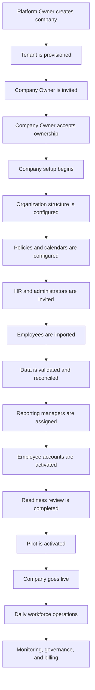
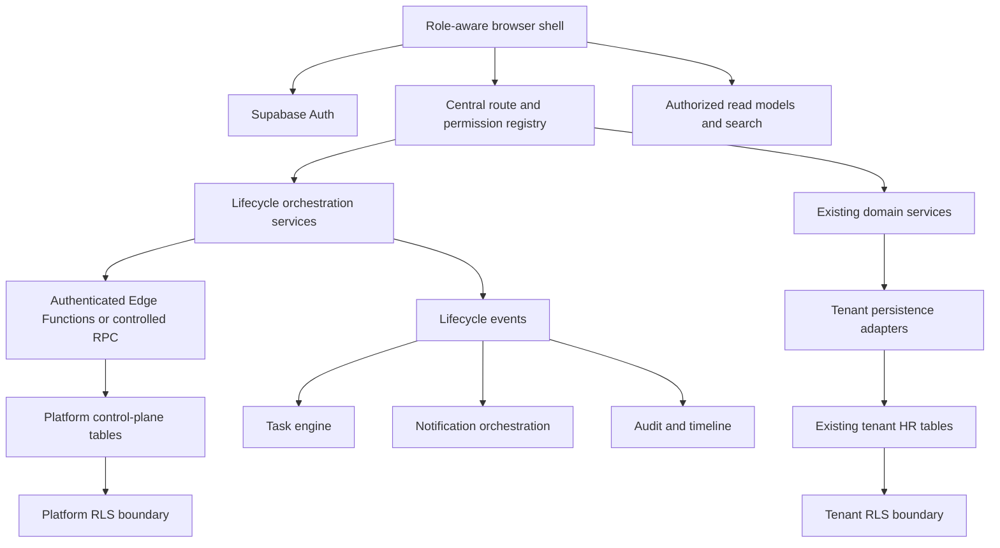
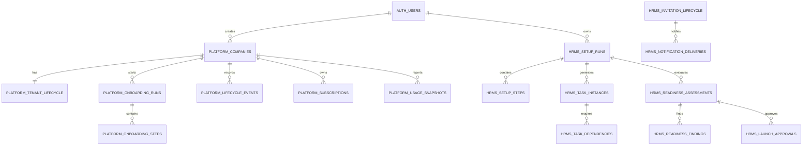
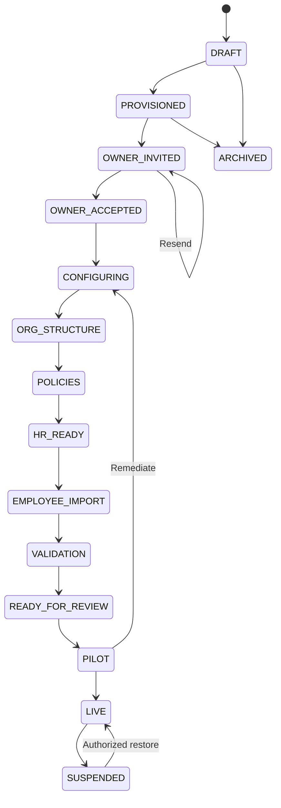
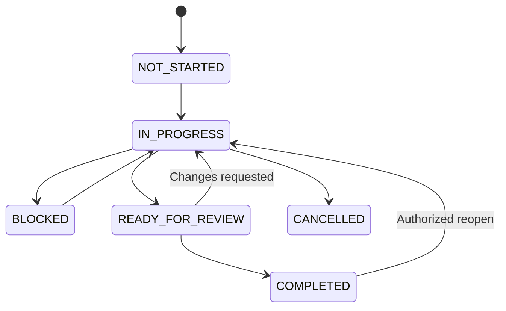
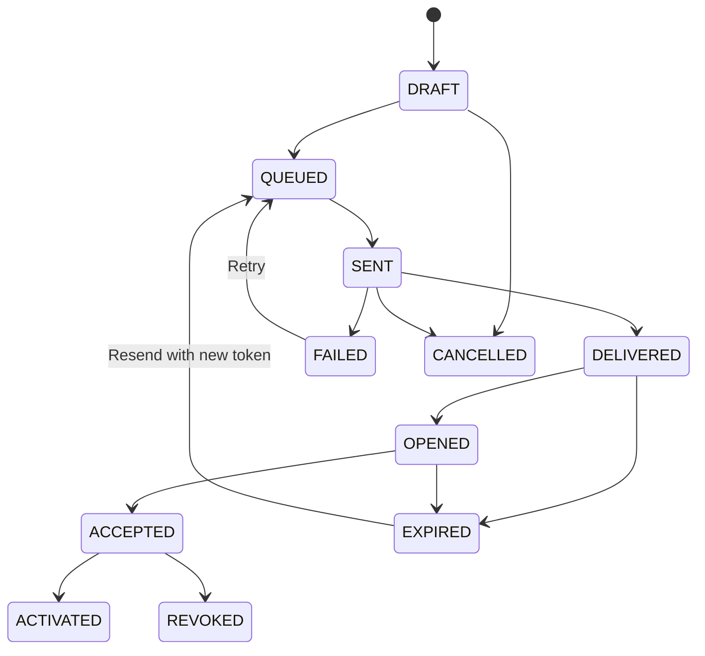
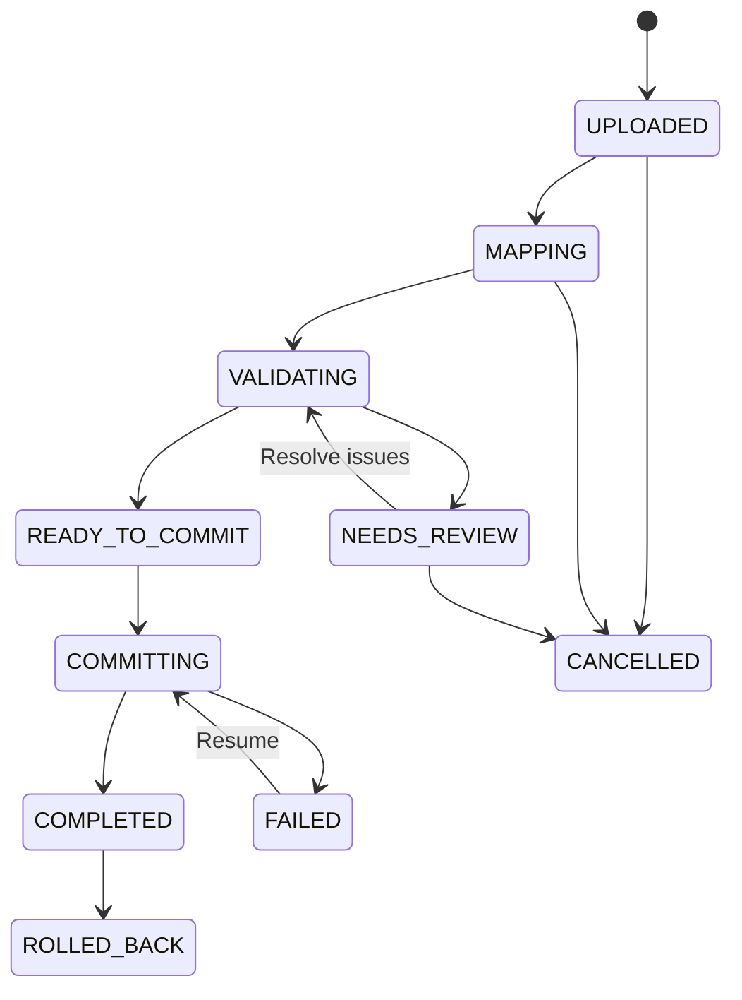
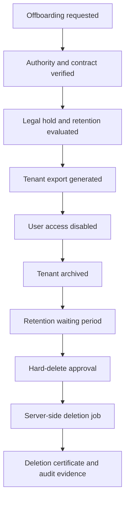

# ArthHRMS Enterprise Solution Blueprint v2

Status: Draft for approval  
Version: 2.1  
Date: 2026-07-25  
Decision owner: ArthHRMS Product and Architecture Steering Group  
Implementation status: Not started

Revision 2.1 adds the mandatory enterprise data governance, observability, security,
scalability, event, background job, reporting, AI, extension, design-system, quality,
success-metric, documentation, and final change-control requirements.

## 1. Document Purpose

This document is the authoritative approval baseline for transforming ArthHRMS from
a collection of enterprise modules into one connected, commercially deployable,
multi-tenant HRMS product.

It consolidates:

- Product Design Document (PDD)
- Business Requirements Document (BRD)
- Functional Requirements Specification (FRS)
- Technical Design Document (TDD)
- Entity Relationship Design (ERD)
- API specifications
- Role and permission matrices
- Lifecycle state machines
- UX design system
- testing strategy
- migration, rollback, and rollout plans

No implementation may begin until this document is approved. Later implementation
changes that alter an approved boundary must update this blueprint through versioned
architecture governance.

## 2. Executive Decision

ArthHRMS will operate through three isolated product planes:

1. Platform Control Plane
2. Company Administration Plane
3. Workforce Plane

The Platform Owner controls the SaaS platform but never performs tenant HR work or
reads tenant employee and payroll records.

Every company receives a Company Owner. In the initial compatible implementation,
Company Owner is a business persona backed by the existing `super_admin` role. This
avoids a breaking authentication or RBAC migration.

Every tenant follows one durable lifecycle from company creation to production:

`DRAFT -> PROVISIONED -> OWNER_INVITED -> OWNER_ACCEPTED -> CONFIGURING ->
ORG_STRUCTURE -> POLICIES -> HR_READY -> EMPLOYEE_IMPORT -> VALIDATION ->
READY_FOR_REVIEW -> PILOT -> LIVE`

## 3. Verified Current Baseline

The source audit covered:

- 37 HTML entry points
- 203 browser service files
- 173 automated test files
- 6 deployed Supabase migrations
- authentication, callback, recovery, invitation, route guard, and RBAC services
- tenant persistence, organization setup, employee import, and platform governance
- build, runtime configuration, Vercel, and deployment verification paths

Current strengths:

- separate Platform Owner and company login surfaces
- one canonical browser Supabase client
- trusted `app_metadata` roles and tenant claims
- shared fail-closed route authorization
- forced RLS on tenant business tables
- Platform Owner exclusion from tenant HR persistence
- secure invite Edge Function boundary
- recovery and invite callback separation
- broad domain service and test coverage

Current transformation blockers:

- no deployed durable Platform Owner company registry and tenant lifecycle
- company provisioning has no durable owner handoff or next-action workflow
- the existing setup experience assigns tenant HR configuration to Platform Owner
- tenant operational capabilities appear inside Platform Control
- onboarding progress is not one server-backed cross-device lifecycle
- invitation status is distributed across multiple services and screens
- multiple navigation labels resolve to the same monolithic panel
- tenant pages include role-incompatible Platform Control links
- Employee Migration links to a missing `employees.html` page
- Platform Control remains a large static document and startup payload
- the current checked build artifact fails deployment verification because its
  runtime environment is `local`, not `production` or `unconfigured`

## 4. Product Design Document

### 4.1 Product Vision

ArthHRMS enables an enterprise to move safely from tenant creation through workforce
operations without requiring product knowledge, technical intervention, or navigation
between disconnected centers.

Every user must understand:

- where they are
- what they own
- what is complete
- what is blocked
- what must happen next
- who is responsible
- when the action is due

### 4.2 Product Principles

1. One lifecycle, many role-owned steps.
2. One primary next action per screen.
3. No role performs another plane's responsibilities.
4. Server state is the source of truth for business progress.
5. Authorization is enforced independently of navigation visibility.
6. Existing domain services are reused through orchestration adapters.
7. Every transition is validated, versioned, and audited.
8. Legacy routes remain operational until replacement parity is certified.
9. Aggregate platform analytics never expose tenant personal or payroll data.
10. Accessibility and performance are release criteria, not optional polish.

### 4.3 Product Planes

#### Platform Control Plane

Audience: Platform Owner

Responsibilities:

- Company Directory
- Tenant Lifecycle
- Platform Users and Identity
- Billing and subscriptions
- Platform analytics
- Monitoring and system health
- Deployments and infrastructure
- Integrations and provider health
- Governance, security, compliance, backup, and recovery
- Platform branding and feature flags
- Support and settings

Excluded:

- employee import
- employee activation
- employee profiles
- tenant departments and designations
- tenant leave, attendance, payroll, and workflow configuration
- tenant documents, performance, recruitment, training, and expenses

#### Company Administration Plane

Audience: Company Owner, Admin, HR Head, HR

Responsibilities:

- Company Profile and legal information
- Branding, addresses, locations, and organization structure
- Working calendar, holidays, attendance, leave, and shifts
- Payroll configuration and readiness
- Approval workflows
- Company users, roles, invitations, and delegated administration
- Employee import, validation, duplicate resolution, and activation
- Company reports, audit, readiness, pilot, and Go-Live

#### Workforce Plane

Audience: Manager, Director, Employee

Responsibilities:

- self-service profile and documents
- attendance and leave
- payslips and tax documents
- expenses and training
- performance and goals
- team approvals and reviews
- strategic read-only oversight

### 4.4 Product Success Metrics

| Metric | Target |
| --- | ---: |
| Companies completing mandatory onboarding | >= 90% |
| Median setup time for a 200-person company | <= 5 business days |
| Setup progress lost across sessions or devices | 0 |
| Sessions ending on a product dead end | < 1% |
| Unauthorized cross-plane navigation | 0 |
| Cross-tenant data access | 0 |
| Employee import completion for 200 records | <= 30 minutes |
| Critical accessibility violations | 0 |
| Unhandled onboarding runtime errors | 0 |
| Main-thread tasks over 200 ms in primary flows | 0 |

### 4.5 Product Non-Goals

- replacing Supabase
- rewriting the application in a new frontend framework
- redesigning payroll, attendance, leave, or other domain calculations
- weakening or bypassing existing RBAC and RLS
- giving Platform Owner access to tenant HR records
- introducing a new auth role for Company Owner in the first release
- deleting legacy routes before migration evidence exists

## 5. Business Requirements Document

### 5.1 Business Objective

ArthHRMS must onboard and activate a paying enterprise without engineering support,
while maintaining provable tenant isolation, operational ownership, and auditability.

### 5.2 Business Personas

| Persona | Business outcome |
| --- | --- |
| Platform Owner | Safely creates, monitors, governs, and bills companies |
| Company Owner | Accepts ownership and makes the tenant operational |
| Admin | Maintains organization and technical company configuration |
| HR Head | Governs HR policy, data readiness, and approvals |
| HR | Operates employee, policy, import, document, and payroll processes |
| Manager | Supervises and approves work for a defined team |
| Director | Reviews strategic and exception-level information |
| Employee | Completes personal workforce activities |

### 5.3 End-to-End Business Journey



### 5.4 Business Rules

1. A company cannot enter `PROVISIONED` without a durable tenant record.
2. A Company Owner must be invited before tenant configuration can begin.
3. Tenant configuration is performed only by tenant roles.
4. A dependent onboarding step cannot complete while its prerequisite is incomplete.
5. Employee import cannot commit before validation and duplicate review.
6. Production activation requires mandatory readiness checks and approvals.
7. Critical readiness findings cannot be overridden silently.
8. Every override requires authorization, reason, timestamp, and audit evidence.
9. Platform analytics may contain counts and aggregates, never salary or employee rows.
10. Suspension and rollback preserve audit history and do not delete business data.

### 5.5 Business Acceptance Scenario

The initial certification scenario is Tabsons India Pvt Ltd with approximately 200
employees. Acceptance requires:

- company and tenant creation
- Company Owner invitation and activation
- complete organization and policy setup
- HR and manager invitations
- employee import with mapping, duplicate detection, and validation
- reporting-manager assignment
- employee account activation
- pilot readiness approval
- controlled Go-Live
- post-launch monitoring and audit verification

## 6. Functional Requirements Specification

### 6.1 Platform Company Management

| ID | Requirement | Acceptance condition |
| --- | --- | --- |
| FR-PLT-001 | Create company | Durable company and lifecycle records exist |
| FR-PLT-002 | Provision tenant | Operation is idempotent, audited, and retryable |
| FR-PLT-003 | Create Company Owner invitation | Invite is tenant-bound and role is trusted |
| FR-PLT-004 | View lifecycle | Current state, history, blockers, and owner are shown |
| FR-PLT-005 | Suspend or archive tenant | State changes without deleting tenant records |
| FR-PLT-006 | View aggregates | No employee-level or payroll payload is returned |

### 6.2 Company Setup

| ID | Requirement | Acceptance condition |
| --- | --- | --- |
| FR-SET-001 | Persist setup run | Progress resumes across browser and device |
| FR-SET-002 | Autosave steps | Valid changes are versioned with visible save state |
| FR-SET-003 | Enforce prerequisites | Blocked steps explain the missing dependency |
| FR-SET-004 | Track ownership | Each step has role, assignee, due date, and status |
| FR-SET-005 | Review before publish | Draft changes are summarized before activation |
| FR-SET-006 | Roll back versions | Previous supported configuration is restorable |

Mandatory setup steps:

1. Company Profile
2. Branding
3. Legal Information
4. GST and PAN when applicable
5. Registered and operating addresses
6. Locations
7. Departments
8. Business Units
9. Designations and grades
10. Working Calendar
11. Holiday Calendar
12. Attendance Rules
13. Leave Rules
14. Payroll Basics
15. Approval Workflow
16. Company Owner verification
17. HR Admin invitation
18. Manager invitation
19. Employee Import
20. Data Validation
21. Readiness
22. Pilot
23. Go-Live

Country-specific identifiers such as GST and PAN are conditional, not globally
mandatory.

### 6.3 Task Engine

| ID | Requirement |
| --- | --- |
| FR-TSK-001 | Create tasks from lifecycle and domain events |
| FR-TSK-002 | Assign tasks to a trusted user or role |
| FR-TSK-003 | Support priority, due date, dependencies, and progress |
| FR-TSK-004 | Prevent completion when required evidence is missing |
| FR-TSK-005 | Record completion, reassignment, escalation, and cancellation |
| FR-TSK-006 | Show role-specific tasks on every dashboard |

### 6.4 Notification Engine

| ID | Requirement |
| --- | --- |
| FR-NTF-001 | Emit notification requests from approved lifecycle events |
| FR-NTF-002 | Support in-app and email channels initially |
| FR-NTF-003 | Track queued, sent, delivered, failed, and retried states |
| FR-NTF-004 | Prevent notification failures from corrupting business transactions |
| FR-NTF-005 | Preserve an auditable relationship to the source event |

### 6.5 Invitation Center

| ID | Requirement |
| --- | --- |
| FR-INV-001 | Display all authorized tenant invitations |
| FR-INV-002 | Support create, send, resend, cancel, and revoke |
| FR-INV-003 | Resend supersedes the previous usable token |
| FR-INV-004 | Activation uses authenticated callback validation |
| FR-INV-005 | Recovery never executes invite employee-linking behavior |
| FR-INV-006 | Every state transition is audited |

### 6.6 Workforce Data Hub

| ID | Requirement |
| --- | --- |
| FR-IMP-001 | Download a versioned import template |
| FR-IMP-002 | Upload Excel or CSV under authenticated tenant context |
| FR-IMP-003 | Map and validate columns before commit |
| FR-IMP-004 | Detect exact and supported fuzzy duplicates |
| FR-IMP-005 | Preview all material data changes |
| FR-IMP-006 | Commit transactionally with checkpoint evidence |
| FR-IMP-007 | Assign managers before account activation |
| FR-IMP-008 | Create accounts and invitations only after approval |
| FR-IMP-009 | Generate a downloadable import report |
| FR-IMP-010 | Support authorized rollback without cross-tenant access |

### 6.7 Readiness and Go-Live

| ID | Requirement |
| --- | --- |
| FR-LIVE-001 | Evaluate mandatory setup and data checks |
| FR-LIVE-002 | Classify critical, warning, and informational findings |
| FR-LIVE-003 | Block Pilot or Live when critical checks fail |
| FR-LIVE-004 | Require Company Owner approval |
| FR-LIVE-005 | Require platform activation gate without tenant data access |
| FR-LIVE-006 | Persist approval, evidence, version, and effective timestamp |
| FR-LIVE-007 | Support maintenance, rollback, and suspension states |

### 6.8 Global Search

Search results must be filtered by both plane and authorization:

- Platform Owner: companies, platform users, platform audit, incidents, navigation
- Company roles: authorized employees, departments, policies, invitations, audit,
  payroll, leave, attendance, reports, and navigation
- Manager: team-scoped people and workflow results
- Employee: own resources and generally visible company reference data

Search must never use hidden results as an authorization boundary.

## 7. Non-Functional Requirements

### 7.1 Security

- fail-closed route and service authorization
- trusted `app_metadata` role and tenant claims
- forced RLS on all tenant and platform tables
- no service role key in browser runtime
- no role or tenant trust from URL parameters
- session expiration and identity-continuity validation
- one-time invitation and recovery behavior
- immutable audit evidence for privileged transitions
- rate limiting for provisioning, invitation, search, and import commands

### 7.2 Performance

- primary route interaction response within 100 ms
- loading feedback for operations exceeding 300 ms
- no synchronous user-facing task over 200 ms
- initial shell loads only the active module
- large tables use pagination or virtualization
- imports use background or chunked processing
- global search is debounced and server limited

### 7.3 Availability and Recovery

- commands are idempotent
- failed external notifications are retryable
- interrupted onboarding resumes safely
- provisioning failure preserves evidence and supports compensation
- launch rollback does not delete tenant data

### 7.4 Accessibility

- WCAG 2.2 AA target
- complete keyboard operation
- visible focus
- semantic landmarks and headings
- accessible names for controls
- live regions for loading and validation
- non-color status indicators
- responsive operation at 320 CSS pixels

## 8. Technical Design Document

### 8.1 Logical Architecture



### 8.2 Frontend Architecture

The first implementation remains framework-neutral and compatible with the existing
static multi-page application.

New boundaries:

- `RouteRegistry`: route, plane, role, breadcrumb, and module metadata
- `ApplicationShell`: shared plane-aware layout
- `ModuleLoader`: lazy initialization and cancellation
- `LifecycleClient`: onboarding and transition API adapter
- `TaskClient`: role task read and mutation adapter
- `SearchClient`: authorized search adapter
- `ReadinessClient`: readiness evaluation and approval adapter

Existing global services remain operational while adapters are introduced. No bulk
conversion to a new framework is included in Blueprint v2.

### 8.3 Backend Architecture

Privileged multi-record operations must use Edge Functions or controlled Postgres
functions. Browser clients may perform ordinary tenant CRUD only where existing RLS
already authorizes it.

Platform provisioning must not write through tenant persistence. It requires a
dedicated platform schema boundary with server-authorized commands.

### 8.4 Event Architecture

Every accepted lifecycle command creates one canonical event:

```text
event_id
event_type
aggregate_type
aggregate_id
tenant_id
organization_id
previous_state
new_state
actor_user_id
actor_role
correlation_id
idempotency_key
reason
metadata
occurred_at
```

Events drive timeline projections, tasks, and notification requests. Notification
failure does not roll back an already committed business transition.

## 9. Entity Relationship Design

Existing tenant identifiers are `text` and existing authenticated users use UUID
references to `auth.users`. New tenant orchestration tables must preserve those types.



### 9.1 Platform Tables

#### `platform_companies`

| Column | Type | Constraint |
| --- | --- | --- |
| `id` | uuid | primary key |
| `tenant_id` | text | unique, immutable after provisioning |
| `organization_id` | text | unique within active platform scope |
| `name` | text | required |
| `slug` | text | unique normalized identifier |
| `status` | text | lifecycle-compatible status |
| `country_code` | text | optional during draft |
| `timezone` | text | optional during draft |
| `owner_auth_user_id` | uuid | nullable until accepted |
| `revision` | bigint | optimistic concurrency |
| `created_by` | uuid | required |
| `created_at` | timestamptz | required |
| `updated_at` | timestamptz | required |

Indexes:

- unique normalized `slug`
- `(status, updated_at desc)`
- `(owner_auth_user_id)`

#### `platform_tenant_lifecycle`

One current-state row per company with state, state version, blockers summary, owner,
effective timestamp, and last event.

#### `platform_lifecycle_events`

Append-only event records. Update and delete are not granted to browser roles.

### 9.2 Tenant Orchestration Tables

All tenant tables include:

- `tenant_id text not null`
- `organization_id text not null`
- `updated_by uuid`
- created and updated timestamps
- tenant indexes
- forced RLS

Setup and task tables use normalized columns for status, ownership, due date, and
version while retaining JSONB only for extensible evidence and non-critical metadata.

### 9.3 Data Retention

- audit and lifecycle events: immutable retention according to enterprise policy
- expired invitations: retained as non-secret lifecycle evidence
- raw import files: restricted retention window
- import reports: policy-controlled retention
- notification bodies: minimize personal data and apply retention policy

## 10. API Specifications

These are versioned logical contracts. Physical Edge Function names may follow current
deployment naming, but request and response semantics must remain stable.

### 10.1 Standard Command Contract

Request headers:

```text
Authorization: Bearer <Supabase access token>
Content-Type: application/json
Idempotency-Key: <caller-generated UUID>
X-Correlation-ID: <trace UUID>
```

Success envelope:

```json
{
  "ok": true,
  "data": {},
  "correlationId": "uuid",
  "version": 1
}
```

Error envelope:

```json
{
  "ok": false,
  "error": {
    "code": "STABLE_MACHINE_CODE",
    "message": "Safe user-facing message",
    "retryable": false,
    "fieldErrors": {}
  },
  "correlationId": "uuid"
}
```

### 10.2 Platform Commands

| Method and route | Role | Purpose |
| --- | --- | --- |
| `POST /functions/v1/platform-company-create` | Platform Owner | Create draft company |
| `POST /functions/v1/platform-tenant-provision` | Platform Owner | Provision tenant idempotently |
| `POST /functions/v1/platform-owner-invite` | Platform Owner | Invite first Company Owner |
| `GET /functions/v1/platform-company-lifecycle` | Platform Owner | Read lifecycle and blockers |
| `POST /functions/v1/platform-lifecycle-transition` | Platform Owner | Perform allowed platform transition |
| `POST /functions/v1/platform-tenant-suspend` | Platform Owner | Suspend without deleting data |

### 10.3 Company Setup Commands

| Method and route | Role | Purpose |
| --- | --- | --- |
| `GET /functions/v1/company-setup` | Company Owner, Admin, HR | Read authorized setup projection |
| `PATCH /functions/v1/company-setup-step` | Step-authorized role | Autosave a draft step |
| `POST /functions/v1/company-setup-complete` | Step-authorized role | Validate and complete a step |
| `POST /functions/v1/company-setup-reopen` | Company Owner | Reopen an allowed step |
| `GET /functions/v1/company-tasks` | Authenticated tenant role | Read assigned tasks |
| `POST /functions/v1/company-task-complete` | Assignee or authorized delegate | Complete task |

### 10.4 Invitation Commands

| Method and route | Role | Purpose |
| --- | --- | --- |
| `POST /functions/v1/invite-user` | Existing authorized tenant role | Existing secure invitation |
| `POST /functions/v1/invitation-resend` | Authorized tenant role | Supersede and resend |
| `POST /functions/v1/invitation-cancel` | Authorized tenant role | Cancel pending invitation |
| `GET /functions/v1/invitations` | Authorized tenant role | Read lifecycle projection |

Invite activation continues through the existing authenticated callback and controlled
activation RPC.

### 10.5 Readiness Commands

| Method and route | Role | Purpose |
| --- | --- | --- |
| `POST /functions/v1/readiness-evaluate` | Company Owner, Admin, HR Head | Generate assessment |
| `POST /functions/v1/readiness-approve` | Required approver | Record scoped approval |
| `POST /functions/v1/pilot-activate` | Company Owner plus platform gate | Activate Pilot |
| `POST /functions/v1/company-go-live` | Company Owner plus platform gate | Activate Live |
| `POST /functions/v1/company-rollback` | Authorized incident role | Roll back activation |

### 10.6 Search API

`GET /functions/v1/authorized-search?q=<query>&scope=<scope>&cursor=<cursor>`

The server derives role, tenant, and allowed scopes from authenticated claims. Search
results include a route only when both the resource and destination are authorized.

## 11. Role and Permission Matrix

### 11.1 Plane Access

| Role | Platform Plane | Company Admin Plane | Workforce Plane |
| --- | ---: | ---: | ---: |
| Platform Owner | Full platform scope | No tenant HR access | No |
| Company Owner / `super_admin` | No | Full tenant ownership | Optional personal access |
| Admin | No | Configuration scope | Optional personal access |
| HR Head | No | HR governance scope | Personal access |
| HR | No | HR operational scope | Personal access |
| Manager | No | No general administration | Team and personal scope |
| Director | No | No general administration | Strategic and approval scope |
| Employee | No | No | Self scope |

### 11.2 Capability Matrix

| Capability | Platform Owner | Company Owner | Admin | HR Head | HR | Manager | Employee |
| --- | ---: | ---: | ---: | ---: | ---: | ---: | ---: |
| Create company | Yes | No | No | No | No | No | No |
| Provision tenant | Yes | No | No | No | No | No | No |
| Read tenant HR rows | No | Authorized | Scoped | Authorized | Authorized | Team | Self |
| Configure company profile | No | Yes | Yes | Scoped | Scoped | No | No |
| Configure policies | No | Approve | Yes | Yes | Yes | No | No |
| Configure payroll | No | Approve | Scoped | Scoped | Authorized | No | No |
| Invite Company Owner | Yes | No | No | No | No | No | No |
| Invite tenant administrators | No | Yes | Scoped | Scoped | No | No | No |
| Invite managers and employees | No | Yes | Yes | Yes | Yes | Employee only if delegated | No |
| Import employees | No | Yes | Yes | Yes | Yes | No | No |
| Approve team requests | No | Optional | Optional | Escalation | Escalation | Yes | No |
| Approve tenant readiness | Platform gate | Final tenant gate | Evidence | Evidence | Evidence | No | No |
| View salary data | No | Policy controlled | No by default | Policy controlled | Authorized | No | Self payslip |
| View platform analytics | Yes | No | No | No | No | No | No |

Permissions must be enforced by route policy, service authorization, and RLS. The
matrix does not replace any of those layers.

## 12. State Machines

### 12.1 Tenant Lifecycle



### 12.2 Setup Step



### 12.3 Invitation



### 12.4 Import



### 12.5 Task

`OPEN -> IN_PROGRESS -> BLOCKED -> IN_PROGRESS -> COMPLETED`

Terminal alternatives: `CANCELLED`, `EXPIRED`, `SUPERSEDED`.

### 12.6 Notification Delivery

`CREATED -> QUEUED -> SENDING -> SENT -> DELIVERED`

Failure path: `SENDING -> FAILED -> RETRY_SCHEDULED -> SENDING -> DEAD_LETTER`.

## 13. Information Architecture and Navigation Blueprint

### 13.1 Platform Navigation

```text
Home
Companies
  Company Directory
  Provisioning
  Tenant Lifecycle
  Usage and Subscription
Platform Identity
Billing
Operations
  Deployments
  Monitoring
  System Health
  Integrations
  Incidents
Governance
  Security
  Audit
  Compliance
  Backup and Recovery
Feature Flags
Platform Branding
Platform Analytics
Support
Settings
```

### 13.2 Company Administration Navigation

```text
Setup Home
Organization
  Company Profile
  Legal Information
  Branding
  Locations
  Departments
  Business Units
  Designations
  Reporting Hierarchy
People
  Employees
  Workforce Data Hub
  Invitations
  Data Quality
  Documents
Time and Leave
  Working Calendar
  Holidays
  Attendance Policies
  Leave Policies
  Shifts and Rosters
Payroll
Talent
  Recruitment
  Onboarding
  Training
  Performance
Workflows
Workplace
  Expenses
  Assets
  Help Desk
  Communications
Reports and Analytics
Company Users and Roles
Readiness and Launch
Audit
Settings
```

### 13.3 Workforce Navigation

Employee:

- Home
- My Profile
- Attendance
- Leave
- Schedule
- Documents
- Expenses
- Performance
- Training
- Payslips
- Notifications

Manager:

- Team Home
- Team Members
- Approvals
- Attendance
- Leave
- Schedule
- Performance
- Tasks
- Notifications

Director:

- Strategic Home
- Risk and Exceptions
- Approval Backlog
- KPI Trends
- Reports

## 14. User and Screen Journeys

### 14.1 Platform Handoff

```text
Platform Login
-> Companies
-> Create Company
-> Provisioning Progress
-> Provisioning Result
-> Create Company Owner
-> Send Invitation
-> Handoff Status
-> Tenant Lifecycle Timeline
```

### 14.2 Company Owner First Login

```text
Invitation Callback
-> Password Setup
-> Ownership Confirmation
-> Welcome
-> Setup Home
-> First Mandatory Step
```

### 14.3 HR First Login

```text
Invitation Callback
-> Welcome
-> Assigned Setup Tasks
-> Configure Policies
-> Workforce Data Hub
-> Invite Managers
```

### 14.4 Employee Activation

```text
Invitation Callback
-> Password Setup
-> Profile Completion
-> Required Documents
-> Bank and Tax Details
-> ESS Home
```

### 14.5 No-Dead-End Rule

Every completion surface must provide:

1. completion confirmation
2. resulting business state
3. generated tasks or notifications
4. one recommended next action
5. alternative return destination

Toast-only completion is not sufficient for lifecycle operations.

## 15. UX Design System

### 15.1 Foundations

- 4 px spacing base with 8 px primary rhythm
- card radius no greater than 8 px unless an existing control requires otherwise
- restrained neutral surfaces with semantic status colors
- no viewport-width font scaling
- no negative letter spacing
- predictable content widths and stable control dimensions
- light and dark token readiness without requiring dark mode in the first release

### 15.2 Semantic Tokens

```text
surface.page
surface.section
surface.raised
border.default
border.strong
text.primary
text.secondary
text.disabled
action.primary
action.danger
status.success
status.warning
status.error
status.info
focus.visible
```

Semantic tokens must not contain tenant branding values directly. Company branding is
applied through a constrained theme layer.

### 15.3 Core Components

- ApplicationShell
- PlaneNavigation
- ContextHeader
- Breadcrumbs
- GlobalSearch
- CommandMenu
- LifecycleProgress
- NextActionPanel
- TaskList and TaskDetails
- InvitationStatus
- ReadinessScore
- BlockingIssueList
- LifecycleTimeline
- DataTable
- FilterBar
- Pagination
- EmptyState
- SkeletonLoader
- LoadingOverlay
- TopProgressBar
- ToastCenter
- ConfirmationDialog
- ErrorBoundary

### 15.4 Interaction Standards

- familiar icons from the existing icon library
- icon buttons include tooltips and accessible names
- action buttons expose loading and disabled states
- destructive actions require explicit confirmation and impact summary
- tables support keyboard navigation, captions, and responsive alternatives
- wizards keep progress stable when content changes
- focus moves to the first invalid field after failed validation
- async status is announced through an ARIA live region

### 15.5 Responsive Standards

- 320-767 px: single-column task-first layout
- 768-1199 px: collapsible navigation and responsive tables
- 1200 px and above: persistent navigation and multi-column administration surfaces

No critical workflow may require desktop-only interaction.

## 16. Performance Architecture

1. Load only the active route and module.
2. Externalize large inline application programs incrementally.
3. Replace global initialization with cancellable module initialization.
4. Paginate or virtualize company, employee, audit, and task datasets.
5. Debounce search and filter input.
6. Cache immutable reference data and short-lived authorized read models.
7. Use background workers or chunked browser yielding for parsing where safe.
8. Execute imports and readiness assessments as background jobs.
9. Use one loading, progress, toast, and error-recovery service.
10. Capture route timings, long tasks, API latency, and failed operations.

Performance budgets:

| Budget | Target |
| --- | ---: |
| Shell interaction response | <= 100 ms |
| Loading feedback threshold | 300 ms |
| Largest synchronous UI task | < 200 ms |
| Search debounce | 150-250 ms |
| Initial critical JavaScript | Measured and reduced per release |
| Large table DOM rows | Virtualized or page limited |

## 17. Testing Strategy

### 17.1 Test Pyramid

1. Unit tests for validators, state transitions, scoring, and authorization helpers.
2. Service contract tests for orchestration adapters.
3. Database tests for functions, triggers, constraints, and RLS.
4. Integration tests for Auth, Edge Functions, Storage, and persistence.
5. Browser workflow tests for every role and lifecycle.
6. Performance, accessibility, security, backup, and recovery certification.

### 17.2 Mandatory Regression Suites

- Platform Owner login and isolation
- company login and role routing
- invite, recovery, magic-link, and email-confirmation callbacks
- session restore, expiry, and rotation
- page authorization and direct URL access
- Company Owner persona backed by `super_admin`
- HR, Admin, Manager, Director, and Employee permissions
- tenant and organization RLS
- employee, attendance, leave, payroll, documents, and reports
- existing import, rollback, audit, and telemetry behavior

### 17.3 Lifecycle Tests

For every transition:

- valid transition succeeds
- invalid previous state fails
- missing permission fails
- missing tenant fails
- cross-tenant request fails
- duplicate idempotency key returns the original result
- stale revision fails
- audit event exists
- task and notification projections are generated safely

### 17.4 Security Tests

- no Platform Owner tenant HR access
- no tenant role platform access
- no URL role or tenant trust
- no mutable `user_metadata` authorization
- RLS probes for every new table
- anonymous grants revoked
- service role absent from browser assets
- invitation token expiry, reuse, resend, cancel, and revoke
- unauthorized search result suppression
- stored and reflected XSS validation
- file import content and size validation

### 17.5 Accessibility Tests

- automated WCAG scanning
- full keyboard walkthrough
- screen-reader labels and status announcements
- focus order and modal focus trapping
- zoom and 320 px reflow
- reduced-motion behavior
- color-independent status communication

### 17.6 Performance Tests

- Platform Control cold and warm startup
- navigation and click latency
- 200-employee import
- 10,000-row table rendering
- search latency
- readiness assessment
- memory growth during repeated navigation
- API p50, p95, and p99

### 17.7 Release Gates

Implementation cannot advance to the next rollout phase unless:

- all existing tests pass
- new tests pass
- build is reproducible
- deployment verification passes
- migration and rollback rehearsal pass
- no critical security or accessibility finding remains
- authorized product owner accepts the phase workflow

## 18. Requirements Traceability

| Business capability | Functional requirements | Data boundary | API boundary | Primary tests |
| --- | --- | --- | --- | --- |
| Company creation | FR-PLT-001..003 | Platform company/lifecycle | Platform commands | Platform lifecycle and RLS |
| Company setup | FR-SET-001..006 | Setup runs/steps | Setup commands | Resume, prerequisite, version |
| Tasks | FR-TSK-001..006 | Tasks/dependencies | Task commands | Ownership and completion |
| Notifications | FR-NTF-001..005 | Delivery projection | Notification worker | Retry and non-rollback |
| Invitations | FR-INV-001..006 | Invitation lifecycle | Invite commands/callback | Expiry, resend, activation |
| Employee import | FR-IMP-001..010 | Existing import records | Existing import plus adapters | Validation, rollback, isolation |
| Go-Live | FR-LIVE-001..007 | Readiness/approvals/events | Readiness commands | Blocker and approval gates |

## 19. Migration Plan

### Phase 0: Baseline and Governance

- approve Blueprint v2
- capture current route, auth, RBAC, RLS, test, build, and performance baselines
- resolve the current deployment-verification artifact mismatch
- establish architecture decision and requirement traceability records

### Phase 1: Durable Platform Boundary

- add platform company, lifecycle, event, and subscription foundations
- add forced RLS and platform-only policies
- create compatibility adapter for current Platform Control tenant models
- migrate valid platform metadata without tenant HR data

### Phase 2: Company Owner Handoff

- create owner invitation after provisioning
- map Company Owner persona to `super_admin`
- persist acceptance and ownership transfer
- add lifecycle timeline and next action

### Phase 3: Plane-Aware Navigation

- introduce route registry and application shells
- remove duplicate navigation destinations
- replace role-incompatible links
- keep legacy deep links available

### Phase 4: Company Setup Orchestration

- introduce server-backed setup run and steps
- reuse existing Company Profile, organization, calendar, policy, and payroll services
- add autosave, resume, prerequisite, review, and version behavior

### Phase 5: Tasks, Invitations, and Notifications

- add role-owned setup tasks
- consolidate invitation lifecycle projections
- connect lifecycle events to notification requests

### Phase 6: Workforce Data Hub

- relocate employee import from Platform Control
- compose existing mapping, validation, duplicate, import, rollback, and analytics services
- connect manager assignment and invitations

### Phase 7: Readiness and Go-Live

- consolidate readiness, validation, approvals, pilot, and launch
- add platform gate without granting tenant HR access
- connect post-launch monitoring

### Phase 8: Legacy Retirement and Optimization

- measure legacy route usage
- redirect confirmed replacements
- remove obsolete setup and duplicate navigation code only after parity
- split large platform and tenant modules into lazy bundles

## 20. Rollback Plan

General rules:

- all schema work is additive during migration
- feature flags select new or legacy orchestration
- existing routes remain available until phase certification
- no rollback deletes tenant HR data or audit events
- new writes retain enough evidence for replay or compensation

Rollback actions:

| Failure | Rollback |
| --- | --- |
| Platform migration failure | Stop deployment before feature activation |
| Provisioning failure | Mark failed, compensate created resources, preserve event |
| Owner invitation failure | Keep tenant provisioned and expose retry task |
| Setup orchestration failure | Route to legacy centers using persisted tenant state |
| Import failure | Use existing transactional rollback and checkpoint recovery |
| Notification provider failure | Queue retry without reverting business state |
| Pilot instability | Return tenant to configuring or maintenance |
| Go-Live failure | Disable activation features and restore approved prior state |
| Navigation regression | Disable new shell flag and restore legacy route entry |

Database down migrations must remove only unused newly added objects and only after
data retention or export approval.

## 21. Rollout Plan

| Stage | Audience | Scope | Exit criteria |
| --- | --- | --- | --- |
| R0 | Engineering | migrations, RLS, adapters | technical gates pass |
| R1 | Internal synthetic tenant | provisioning and owner handoff | no lifecycle blocker |
| R2 | Tabsons administrators | complete company setup | no dead ends |
| R3 | Tabsons HR and managers | import, invites, approvals | business acceptance |
| R4 | Limited Tabsons employees | ESS and workforce flows | support and telemetry healthy |
| R5 | Tabsons Pilot | readiness and operations | pilot acceptance |
| R6 | Tabsons Production | controlled Go-Live | certification signed |
| R7 | Customer cohorts | reusable onboarding | cohort metrics meet targets |

Every rollout stage includes:

- authentication and session checks
- route and action permission checks
- cross-tenant tests
- migration and rollback checks
- accessibility and responsive checks
- performance checks
- audit and observability evidence
- product owner acceptance

## 22. Architecture Decisions Requiring Approval

The recommended decisions are:

1. Company Owner remains a persona mapped to existing `super_admin` in v2.
2. Platform Owner receives no tenant HR table access.
3. Company and tenant lifecycle data receives a dedicated platform persistence
   boundary.
4. Country identifiers such as GST and PAN are conditional by jurisdiction.
5. Existing domain calculations and tenant APIs remain unchanged.
6. Setup orchestration is server-backed and browser storage is not authoritative.
7. The application remains framework-neutral during this transformation.
8. Legacy routes remain until feature-flagged parity and telemetry prove retirement.
9. Pilot precedes Live for every production tenant unless a governed exception is
   approved.
10. Blueprint v2 is the source of truth for implementation scope and acceptance.

## 23. Approval Gate

Approval of Blueprint v2 authorizes only Phase 0 and Phase 1:

1. baseline certification
2. durable platform company registry
3. tenant lifecycle state machine
4. platform lifecycle audit
5. compatibility adapters and tests

Later phases require their own phase-entry review using the approved requirements and
security boundaries in this document.

Implementation must not begin before the following approval record is completed:

| Approval | Name | Decision | Date |
| --- | --- | --- | --- |
| Product |  | Pending |  |
| Architecture |  | Pending |  |
| Security |  | Pending |  |
| Data and Supabase |  | Pending |  |
| QA |  | Pending |  |
| Release |  | Pending |  |

## 24. Enterprise Data Governance

### 24.1 Governance Principles

1. Every data domain has a named business owner and technical custodian.
2. Tenant data remains tenant-owned and tenant-isolated throughout its lifecycle.
3. Platform operations process only the minimum tenant metadata required to operate
   the SaaS platform.
4. Retention, deletion, export, legal hold, backup, and restore actions are policy
   controlled and audited.
5. A user-interface delete action never implies immediate physical destruction.
6. Personal data is collected and retained only for a documented business purpose.
7. Production data is never copied into development without approved anonymization.

### 24.2 Data Ownership

| Data domain | Business owner | Technical custodian | Access boundary |
| --- | --- | --- | --- |
| Platform company metadata | Platform Operations | Platform Engineering | Platform Owner |
| Subscription and billing metadata | Platform Finance | Platform Engineering | Platform Owner and authorized finance process |
| Company configuration | Company Owner | Company Admin and Engineering | Tenant-scoped |
| Employee master data | Company HR | Data Operations | Tenant and role scoped |
| Attendance and leave | Company HR | HR Operations | Tenant, role, and subject scoped |
| Payroll and bank data | Company Finance/Payroll | Payroll Operations | Restricted tenant scope |
| Documents and attachments | Company HR/Data Owner | Storage Operations | Tenant and subject scoped |
| Audit and lifecycle events | Compliance owner | Security Operations | Immutable authorized read |
| Monitoring telemetry | Platform Operations | SRE | Metadata only; no unnecessary HR payloads |

The data controller and processor relationship must be defined contractually for each
customer and jurisdiction. This blueprint defines technical boundaries but does not
replace legal review.

### 24.3 Data Classification

| Class | Examples | Minimum controls |
| --- | --- | --- |
| Public | Published help and public product metadata | Integrity and change control |
| Internal | Non-sensitive configuration and operational metadata | Authenticated access |
| Confidential | Employee profile, attendance, leave, documents | Tenant RLS, encryption, audit |
| Restricted | Salary, bank, tax, government identifiers, credentials | Least privilege, masking, strong audit, limited export |

Secrets, passwords, recovery tokens, refresh tokens, and raw authentication
credentials are not business records and must never be stored in application tables,
logs, exports, or analytics.

### 24.4 Retention Policy

Retention rules are configuration-driven by tenant, data class, jurisdiction, legal
obligation, and contractual policy.

Minimum behavior:

- active records remain available for the operational purpose
- separated-employee records enter a policy-defined retention period
- expired temporary uploads and import staging files are removed automatically
- audit and lifecycle records use a longer immutable retention policy
- payroll and statutory records follow country-specific legal retention
- deletion jobs record counts, policy, actor, and execution evidence

No retention duration is hardcoded globally when jurisdictions differ.

### 24.5 Soft Delete Policy

Business entities that require restoration or historical reference use:

```text
deleted_at
deleted_by
deletion_reason
deletion_request_id
```

Soft-deleted rows:

- are excluded from ordinary queries
- remain tenant-scoped
- cannot be silently restored
- retain relationships required for audit
- can be restored only by an authorized, audited workflow

Authentication revocation and account disabling occur immediately even when the
business record remains soft deleted.

### 24.6 Hard Delete Policy

Hard deletion is permitted only when:

- the retention period has elapsed
- no legal hold exists
- no unresolved financial, compliance, or audit dependency exists
- an authorized deletion request has been approved
- an export or backup requirement has been satisfied
- the operation can prove tenant scope

Hard deletion is executed server-side as a background job. Browser clients cannot
directly cascade-delete a tenant.

### 24.7 Archive Strategy

Archived data is:

- read-only
- removed from primary operational views
- retained with its tenant and organization identity
- stored using encrypted and integrity-verified storage
- discoverable only through authorized archive searches
- restorable through a controlled workflow

Archiving must not weaken RLS or move data into a shared unscoped bucket.

### 24.8 Legal Hold

A legal hold:

- suspends hard deletion and automated retention disposal
- identifies scope, authority, reason, start date, and review date
- is visible only to authorized legal/compliance users
- cannot be overridden by ordinary tenant administration
- is recorded in immutable audit and lifecycle events

Legal hold metadata must not reveal restricted case details to unauthorized users.

### 24.9 GDPR and DPDP Readiness

The platform must support:

- purpose and lawful-basis documentation
- consent records where consent is the applicable basis
- data-subject access and export
- correction workflows
- restriction of processing
- erasure evaluation subject to legal obligations
- processor and subprocessor records
- breach investigation evidence
- retention and deletion enforcement
- privacy-safe audit logs

Requests must be identity-verified and tenant-authorized. Erasure cannot remove records
that the customer must legally retain; those records are restricted and documented
instead.

### 24.10 Backup Policy and Restore SLA

| Data class | Backup objective | Restore verification |
| --- | --- | --- |
| Platform control data | Scheduled full plus incremental/PITR capability | Quarterly restore drill |
| Tenant business data | Database backup and point-in-time recovery | Tenant-isolation validation after restore |
| Object storage | Versioned or equivalent protected backup | Checksum and sample download |
| Configuration and migrations | Source-controlled and release-versioned | Deployment rehearsal |
| Audit evidence | Integrity-protected backup | Append-only integrity verification |

Target service objectives must be contractually selected per plan:

- Critical enterprise target RPO: <= 15 minutes
- Critical enterprise target RTO: <= 4 hours
- Standard target RPO: <= 24 hours
- Standard target RTO: <= 24 hours

These targets are not certified until deployment infrastructure and restore drills
produce evidence.

### 24.11 Data Export Policy

Exports must:

- require authenticated and authorized scope
- apply the same tenant and field restrictions as the source view
- record requester, reason, filters, row count, and file checksum
- use time-limited secure download access
- avoid secrets and internal authorization metadata
- support cancellation and expiration
- use background generation for large datasets

Restricted exports may require approval and data masking.

### 24.12 Tenant Offboarding



Tenant offboarding must support cancellation before the irreversible deletion stage.

### 24.13 Tenant Deletion Workflow

Required approvals:

- customer-authorized representative
- Platform Operations
- Security or Compliance for restricted tenants
- Finance confirmation that contractual obligations are complete

Deletion order must respect dependencies:

1. disable sessions and integrations
2. suspend jobs and outbound notifications
3. preserve required export and audit evidence
4. delete or anonymize tenant business records
5. remove tenant storage objects
6. remove tenant configuration and platform metadata
7. verify no tenant-scoped records remain
8. issue deletion evidence

## 25. Observability and Monitoring

### 25.1 Observability Principles

- logs describe events, not secrets or unrestricted business payloads
- every request and job has a correlation identifier
- tenant identifiers may be logged only in an approved non-sensitive form
- operational telemetry is separated from immutable business audit
- alerts are actionable and mapped to an owner and runbook
- health checks validate dependencies without exposing credentials or internals

### 25.2 Structured Logging

Standard log fields:

```text
timestamp
level
service
environment
release_version
event_name
correlation_id
request_id
job_id
tenant_id_hash_or_authorized_id
actor_user_id_when_allowed
duration_ms
outcome
error_code
retry_count
```

Passwords, tokens, authorization headers, bank details, salaries, government IDs,
document contents, and raw employee payloads are prohibited from logs.

### 25.3 Audit Logs

Audit records answer:

- who performed the action
- under which role and tenant
- what entity and operation were affected
- previous and resulting state or protected change summary
- when and from which approved context
- why an override or privileged action occurred
- which correlation and lifecycle event produced the action

Audit write failures for privileged mutations must fail closed when evidence is a
mandatory business requirement.

### 25.4 Error Tracking

Error tracking must:

- group errors by stable fingerprint
- attach release, route, environment, and correlation metadata
- redact personal and authentication data
- distinguish expected validation from defects
- support source maps without publishing source secrets
- connect high-severity errors to incident management

### 25.5 Metrics

Required metric families:

- authentication success/failure and session refresh
- route and API latency
- database query latency and error rate
- RLS and authorization denials
- import throughput and failure
- invitation delivery and activation
- task backlog and overdue count
- notification queue and provider failure
- payroll and attendance job duration
- storage capacity and upload failures
- onboarding and Go-Live funnel metrics

Metrics must not use employee names, email addresses, or unrestricted identifiers as
high-cardinality labels.

### 25.6 Distributed Tracing

Tracing context propagates through:

```text
Browser request
-> Edge Function or API
-> Database/RPC
-> Background job
-> Notification provider
```

Trace spans include operation names and durations, not sensitive payloads.

### 25.7 Alerting

| Severity | Example | Response expectation |
| --- | --- | --- |
| Critical | Authentication outage, cross-tenant security signal, database unavailable | Immediate paging |
| High | Queue stopped, payroll jobs failing, storage unavailable | On-call response |
| Medium | Elevated API latency, invite provider degradation | Business-hours investigation |
| Low | Capacity trend or non-critical integration warning | Planned remediation |

Alerts require deduplication, suppression windows, ownership, escalation, and runbook
links.

### 25.8 Health Dashboards

Platform dashboards show:

- availability
- latency and error budget
- Supabase/Auth/Database/Storage health
- Edge Function health
- queue and background-job health
- notification-provider health
- active incidents
- release health
- backup and restore evidence

Tenant dashboards show only their own authorized operational readiness and never
platform internals or another tenant's health.

### 25.9 SLA and SLO Monitoring

Each production service defines:

- service-level indicator
- target SLO
- measurement window
- error budget
- escalation owner
- maintenance exclusions

Commercial SLA claims require measured production evidence and must not be inferred
from unit tests.

### 25.10 Background Job and Queue Monitoring

Required signals:

- queued, running, completed, failed, retried, and dead-letter counts
- oldest queued job age
- processing latency and throughput
- worker heartbeat
- retry exhaustion
- tenant fairness and noisy-tenant detection
- scheduled-job execution drift

## 26. Security Hardening

### 26.1 Browser Security

- Content Security Policy is nonce/hash based in the target state
- `unsafe-inline` is removed incrementally with delegated event handling
- Trusted Types remains enabled where supported
- user-controlled content uses safe DOM APIs or approved sanitization
- frame embedding is denied unless explicitly required
- MIME sniffing is disabled
- referrer information is minimized
- permissions policy disables unnecessary browser capabilities

### 26.2 CSRF

Supabase bearer-token requests are protected by authorization headers and strict CORS.
Any future cookie-authenticated mutation must additionally use:

- `SameSite` cookies
- origin and referer validation
- anti-CSRF tokens

State-changing operations never use `GET`.

### 26.3 XSS Prevention

- no unsanitized user data reaches `innerHTML`
- rich text uses an allowlist sanitizer
- URLs and file names are validated before rendering
- exports encode content for the target format
- import previews render text, not executable markup
- CSP violations are monitored

### 26.4 SQL Injection Prevention

- Supabase query builders or parameterized SQL are mandatory
- dynamic SQL uses identifiers from fixed allowlists
- client-provided table and column names are rejected
- security-definer functions set a safe `search_path`
- functions validate tenant and actor internally

### 26.5 Secret Management

- only publishable Supabase keys are present in browser runtime
- service role and provider secrets remain server-side
- secrets are stored in deployment/Supabase secret stores
- secrets are rotated and access reviewed
- logs and errors redact secret values
- secret scanning is part of CI

### 26.6 Session Security

- session expiry is validated before protected rendering
- refresh failures fail closed
- identity continuity is checked between session and user
- sensitive role changes require session re-evaluation
- logout clears application session state
- password recovery and invitation flows do not reuse each other's business logic
- session fixation is prevented through Supabase session issuance and rotation

### 26.7 Rate Limiting and Abuse Protection

Apply actor, tenant, IP-risk, and operation-based limits to:

- login and password recovery
- invitation send/resend
- provisioning
- global search
- imports and exports
- file upload
- expensive reports
- public callbacks and Edge Functions

High-cost tenant workloads require quotas and fair scheduling, not only request
rejection.

### 26.8 MFA Roadmap

1. Require MFA for Platform Owner.
2. Require MFA for Company Owner and privileged administrators.
3. Support tenant-enforced MFA policy.
4. Add recovery-code and factor-revocation governance.
5. Audit factor enrollment, challenge, failure, and removal.

### 26.9 Device and Session Management

Privileged users should be able to:

- view active sessions and recognized devices
- revoke individual or all sessions
- identify last activity and approximate context without invasive tracking
- receive alerts for high-risk session changes

### 26.10 API Security

- exact allowed origins
- stable authorization middleware
- request-size limits
- schema validation
- idempotency for mutations
- replay protection for signed webhooks
- scoped provider credentials
- safe error messages
- API inventory and version ownership

### 26.11 Security Headers

Production responses require, as applicable:

- Content-Security-Policy
- Strict-Transport-Security
- X-Content-Type-Options
- Referrer-Policy
- Permissions-Policy
- frame restrictions through CSP
- cache restrictions on authentication and sensitive pages

### 26.12 Dependency and Supply-Chain Security

- lockfile-enforced reproducible installation
- automated dependency vulnerability scan
- secret scan
- migration and Edge Function static checks
- dependency update review
- release artifact provenance
- protected CI workflows and least-privilege tokens

## 27. Multi-Tenant Scalability

### 27.1 Capacity Model

The architecture must support progressive tiers without claiming unverified capacity.

| Resource | Initial governed limit | Enterprise extension |
| --- | ---: | --- |
| Employees per tenant | Configurable, pilot-tested at 200+ | Target validation up to 100,000 |
| Active tenants | Operationally measured | Target 1,000+ |
| Attachment size | Plan and type constrained | Configurable secured multipart upload |
| Tenant storage | Subscription quota | Expandable with usage billing |
| Concurrent imports | Per-tenant limited | Fair queue scheduling |
| Payroll jobs | One governed active run per pay group | Parallel independent pay groups |
| API request rate | Role/tenant/operation limited | Contractual elevated limits |

Numbers beyond tested evidence remain targets, not certifications.

### 27.2 Tenant Provisioning Limits

- provisioning is queued when platform concurrency is reached
- idempotency prevents duplicate tenants
- unique slug and organization constraints prevent collisions
- provisioning timeouts create retryable failed states
- noisy tenants cannot block other tenant activations

### 27.3 Storage and Attachment Controls

- quota by plan and tenant
- maximum object and request size
- approved MIME and extension combinations
- tenant-scoped storage paths
- malware-scanning extension point
- orphan-object cleanup
- resumable uploads for large approved files

### 27.4 Background Workers and Queue Architecture

Jobs are partitioned logically by:

- workload type
- priority
- tenant
- scheduling requirement

Worker concurrency is controlled per workload and tenant. Payroll jobs cannot be
starved by bulk notifications or reports.

### 27.5 Data Access Scalability

Near-term:

- domain repositories instead of broad tenant snapshots
- indexed incremental queries
- cursor pagination
- aggregate read models
- cache only authorized and non-sensitive projections

Future:

- read replicas for reporting
- partitioning high-volume time-series tables
- tenant-aware archival
- workload-specific databases or schemas where justified

### 27.6 Future Sharding Strategy

Sharding is not implemented in v2. Extension requirements:

- stable global tenant directory maps tenant to data placement
- tenant identity remains immutable
- APIs do not expose physical shard details
- background jobs resolve tenant placement before execution
- cross-tenant platform analytics use aggregate pipelines
- tenant migration between placements is auditable and reversible

### 27.7 Performance Targets

| Operation | Target |
| --- | ---: |
| Authenticated shell interaction | <= 100 ms feedback |
| Standard API p95 | <= 500 ms under certified load |
| Search p95 | <= 750 ms |
| Dashboard critical data | <= 2 seconds under certified load |
| 200-employee import | <= 30 minutes including validation |
| Background job start | <= 60 seconds for normal priority |

Targets require environment-specific load evidence.

## 28. Event-Driven Architecture

### 28.1 Event Standard

Domain events are immutable facts named in past tense. Commands request a change;
events record an accepted change.

Required event envelope:

```text
event_id
event_name
event_version
aggregate_type
aggregate_id
tenant_id
organization_id
producer
actor_user_id
actor_role
correlation_id
causation_id
idempotency_key
occurred_at
payload
classification
```

Payloads contain the minimum information required by consumers. Consumers fetch
authorized details when necessary rather than receiving entire employee or payroll
records.

### 28.2 Domain Event Catalog

| Event | Producer | Consumers | Minimum payload | Retry and audit |
| --- | --- | --- | --- | --- |
| `CompanyCreated` | Platform company service | Lifecycle, audit, task engine | company id, tenant id, creator | Idempotent; immutable audit |
| `TenantProvisioned` | Provisioning service | Owner invitation, monitoring | company id, provision result, version | Retry-safe; platform audit |
| `CompanyOwnerInvited` | Invitation service | Notifications, timeline | invitation id, company id, expiry | Provider retry; invite audit |
| `InvitationAccepted` | Auth callback service | Identity linking, tasks, timeline | invitation id, auth user id | No duplicate activation; auth audit |
| `CompanySetupStepCompleted` | Setup service | Lifecycle, task engine | step id, version, evidence ref | Idempotent; tenant audit |
| `EmployeeImportValidated` | Import service | Task engine, readiness | import id, counts, score | Recomputable; import audit |
| `EmployeeImported` | Import executor | Identity, reports, timeline | import id, committed counts | Transactional outbox; audit |
| `ManagerAssigned` | Hierarchy service | Workflow, notifications | employee id, manager id, effective date | Ordered per employee; audit |
| `LeaveApproved` | Leave workflow | Attendance, payroll, notifications | request id, effective dates | Idempotent consumers; audit |
| `PayrollCompleted` | Payroll service | Payslips, reports, notifications | payroll run id, period, aggregate counts | No salary payload; finance audit |
| `PilotActivated` | Readiness service | Monitoring, timeline | assessment id, approval refs | No blind retry; launch audit |
| `CompanyActivated` | Launch service | Auth features, monitoring, billing | company id, version, timestamp | Idempotent; critical audit |
| `CompanyArchived` | Lifecycle service | Access, jobs, billing | company id, reason, effective date | Controlled retry; audit |

### 28.3 Delivery Semantics

- at-least-once delivery is assumed
- every consumer is idempotent
- ordering is required only within an aggregate where business behavior depends on it
- retries use exponential backoff with bounded attempts
- exhausted events enter a dead-letter state
- replay requires authorization and audit
- business transactions use an outbox or equivalent atomic event-recording pattern

### 28.4 Event Versioning

- additive optional fields do not require a new major event version
- removed, renamed, or behavior-changing fields require a new version
- consumers declare supported versions
- old versions remain replayable for the governed retention period

## 29. Background Jobs

### 29.1 Job Contract

Every job includes:

```text
job_id
job_type
tenant_id
organization_id
priority
status
scheduled_at
attempt
max_attempts
idempotency_key
correlation_id
payload_reference
created_by
started_at
completed_at
error_code
```

Sensitive payloads are stored in authorized data storage and referenced by ID rather
than copied into a generic queue.

### 29.2 Job Catalog

| Job | Trigger | Isolation and retry |
| --- | --- | --- |
| Email delivery | Notification request | Provider-aware retry and dead letter |
| In-app notification fanout | Domain event | Tenant-partitioned and idempotent |
| Payroll generation | Approved payroll run | Restricted worker, checkpointed |
| Attendance calculation | Clock event or schedule | Employee/date idempotency |
| Leave accrual | Scheduled policy evaluation | Tenant and period checkpoint |
| Report generation | Authorized request | Resource-limited with expiring output |
| Scheduled backup verification | Operations schedule | Platform-only, evidence retained |
| Reminder engine | Due task or workflow SLA | Deduplicated by task and schedule |
| Import parsing and validation | File upload | Tenant quota and progress tracking |
| Data retention cleanup | Approved retention schedule | Legal-hold aware |
| Search indexing | Authorized entity event | No unrestricted sensitive fields |

### 29.3 Job Safety

- workers authenticate using server-side credentials
- jobs revalidate tenant and current authorization context where required
- cancelled tenants do not continue outbound or calculation jobs
- checkpoints prevent full restart of long-running work
- partial failure does not create duplicate payroll, attendance, or invitations
- operational job logs contain no prohibited data

## 30. Reporting Architecture

### 30.1 Reporting Domains

| Reporting type | Audience | Data pattern |
| --- | --- | --- |
| Operational Reports | HR and Admin | Current actionable tenant data |
| HR Reports | HR and HR Head | Employees, lifecycle, policies, training |
| Payroll Reports | Authorized Payroll/Finance | Restricted payroll and statutory data |
| Attendance Reports | HR and Managers | Tenant or team-scoped time data |
| Executive Dashboards | Company Owner and Director | Tenant aggregates and trends |
| Platform Analytics | Platform Owner | Cross-tenant aggregates without HR rows |

### 30.2 Read Architecture

- operational screens query indexed tenant repositories
- expensive reports use background generation
- repeated aggregates use governed read models or materialized views
- report definitions are versioned
- report filters are validated server-side
- generated files expire and use secure download access
- platform aggregates are produced through privacy-preserving pipelines

### 30.3 Reporting Security

- report access is authorized independently from navigation
- field-level restrictions apply to salary, bank, tax, and government identifiers
- Manager reports are team-scoped
- Employee reports are self-scoped
- Platform Owner never receives tenant employee rows
- exports receive the same or stricter authorization as interactive reports

### 30.4 Report Audit

Record:

- report and version
- requester and role
- tenant and organization
- filters and requested fields
- row count
- output format
- generated checksum
- expiration and download events

## 31. AI Readiness

AI is not implemented by this blueprint. The architecture provides controlled
extension points only.

### 31.1 Approved Future Capabilities

- HR assistant and policy chatbot
- resume parsing
- document classification and extraction
- semantic and smart search
- workforce trend insights
- predictive analytics
- anomaly and data-quality suggestions

### 31.2 AI Boundary Interfaces

```text
AIRequestGateway
AIProviderAdapter
AuthorizedContextBuilder
PromptTemplateRegistry
RetrievalPolicy
PIIRedactionService
AIResponseValidator
HumanApprovalQueue
AIUsageAudit
```

### 31.3 AI Governance

- AI receives only authorized minimum context
- salary, health, government ID, and legal-hold data require explicit policy
- tenant data is not used to train shared models without contractual authorization
- prompts and outputs are audited using privacy-safe references
- consequential HR decisions require human review
- model outputs are treated as suggestions, not authoritative records
- provider selection, residency, retention, and subprocessor terms are governed
- prompt injection and unsafe document retrieval are security test cases

## 32. Plugin and Extension Framework

### 32.1 Objective

Future integrations must extend defined contracts without modifying core HR business
logic or bypassing security.

### 32.2 Extension Categories

- country payroll and statutory plugins
- attendance and biometric device adapters
- email, SMS, WhatsApp, and push providers
- accounting and banking integrations
- HRIS and employee import connectors
- document-signing providers
- identity, SSO, and directory connectors
- report exporters

### 32.3 Plugin Manifest

Every extension declares:

```text
plugin_id
name
version
contract_version
capabilities
required_permissions
configuration_schema
secret_requirements
supported_events
health_check
data_residency
publisher
signature_or_provenance
```

### 32.4 Extension Rules

- plugins never receive the Supabase service role key
- secrets remain server-side
- tenant installation requires authorized consent
- capabilities are least-privilege scoped
- inputs and outputs use versioned schemas
- provider failures are isolated from core transactions
- every plugin provides health, retry, timeout, and audit behavior
- uninstallation preserves required business and audit records

### 32.5 Compatibility

Core services depend on provider interfaces, not provider implementations. Plugin
contract versions are tested in CI, and incompatible plugins fail closed before
activation.

## 33. Enterprise Design System

Section 15 defines the UX foundation. This section makes that foundation an enterprise
governance contract.

### 33.1 Typography

- one approved UI font stack
- semantic type roles: display, page title, section title, body, label, caption, code
- no viewport-width font scaling
- no negative letter spacing
- minimum readable body size and line-height
- tenant branding cannot replace system fonts with unreadable assets

### 33.2 Color

- semantic tokens rather than component-specific color literals
- WCAG 2.2 AA contrast targets
- statuses include text or icon, not color alone
- tenant themes are validated before activation
- focus indicators remain visible under all themes

### 33.3 Icons

- use the existing approved icon library
- icons have consistent size and stroke
- unfamiliar icon-only actions include tooltips
- meaningful icons include accessible names
- decorative icons are hidden from assistive technology

### 33.4 Buttons and Commands

Variants:

- primary
- secondary
- quiet
- danger
- icon

Every button supports:

- default, hover, focus, active, disabled, and loading states
- stable dimensions during loading
- clear command language
- no duplicate submission

### 33.5 Forms

- visible label for every field
- required and optional status
- inline validation
- input help only where needed
- error summary for multi-field failure
- preserved valid input after failure
- locale-aware date, time, number, and currency behavior

### 33.6 Tables

- caption and column headers
- sorting and filtering state
- pagination or virtualization
- keyboard operation
- empty and filtered-empty states
- responsive alternative for narrow screens
- authorized bulk actions
- no sensitive columns by default

### 33.7 Cards and Panels

Cards are reserved for repeated entities, focused tools, and dialogs. Page sections
remain unframed or use full-width bands. Cards do not nest inside cards.

### 33.8 Dialogs

- descriptive title and impact
- focus trap and return
- Escape behavior when safe
- explicit destructive confirmation
- progress and error recovery
- no critical workflow available only inside an inaccessible modal

### 33.9 Empty States

Every empty state includes:

- factual state
- role-appropriate next action
- permission-aware command
- no fake metrics or demo records

### 33.10 Loading and Feedback

- skeletons for structured content
- top progress for navigation
- delayed overlay for blocking operations
- button-level loading
- centralized success, warning, error, and information toasts
- automatic cleanup on success, failure, cancellation, and timeout

### 33.11 Design-System Governance

- components have documented anatomy, states, accessibility, and examples
- visual changes require responsive and accessibility review
- duplicated local components are migrated to shared foundations
- product teams cannot bypass security or permission services inside UI components

## 34. Quality Gates

No implementation phase or release proceeds unless all applicable gates pass.

| Gate | Required evidence | Blocking condition |
| --- | --- | --- |
| Unit tests | All affected and full suite | Any failure |
| Integration tests | Auth, API, persistence, provider contracts | Critical flow failure |
| End-to-end tests | Role and lifecycle journeys | Mandatory scenario failure |
| RBAC validation | Route, service, action matrix | Unauthorized allow or incorrect deny |
| RLS validation | Cross-role and cross-tenant SQL/API probes | Any tenant escape |
| Performance | Approved benchmark comparison | Budget regression without approval |
| Accessibility | Automated and manual WCAG audit | Critical/serious unresolved issue |
| Security | SAST, dependency, secret, XSS, API review | Critical/high exploitable issue |
| Migration | Clean apply, idempotency, data verification | Migration inconsistency |
| Rollback | Feature, application, and database rehearsal | Required rollback fails |
| Deployment | Deterministic build and deployment verification | Verification failure |
| Observability | Logs, metrics, alerts, runbooks | Critical path unobservable |
| Product acceptance | Approved workflow evidence | Dead end or unmet acceptance criterion |

Every exception:

- names the failed gate
- documents risk and scope
- has Product, Architecture, Security, QA, and Release approval as applicable
- has an expiry date and remediation owner
- is recorded in release audit

## 35. Success Metrics

### 35.1 Product and Onboarding KPIs

| KPI | Definition |
| --- | --- |
| Company onboarding completion rate | Companies reaching Pilot or Live / companies provisioned |
| Average onboarding time | Provisioned timestamp to Ready for Review |
| Time to Company Owner acceptance | Owner invite sent to accepted |
| Employee import success rate | Committed valid records / submitted records |
| Invitation acceptance rate | Activated invitations / delivered invitations |
| Time to first payroll | Live activation to first completed payroll |
| Go-Live success rate | Successful Live activations / attempted activations |
| Setup task completion | Completed mandatory tasks / assigned mandatory tasks |

### 35.2 Adoption KPIs

- weekly and monthly active users by authorized role
- ESS activation and profile completion
- manager approval participation
- attendance and leave workflow adoption
- report and dashboard use
- notification engagement
- feature adoption by tenant without exposing employee behavior to Platform Owner

### 35.3 Reliability and Support KPIs

| KPI | Target or treatment |
| --- | --- |
| Availability | Defined by certified production SLO |
| Error rate | Tracked by API, route, and job |
| Critical incident count | Zero target |
| Mean time to acknowledge | Severity-based |
| Mean time to restore | Severity-based |
| Failed background jobs | Alerted and trended |
| Support ticket volume | Per tenant and active-user normalized |
| Repeat support issues | Root-cause tracked |

### 35.4 Metric Governance

- every KPI has an owner, formula, source, and refresh frequency
- metric definitions are versioned
- production dashboards distinguish target from certified evidence
- personal data is minimized
- Platform Owner cross-tenant metrics are aggregate
- metrics cannot become an undocumented employee-performance decision source

## 36. Documentation Strategy

### 36.1 Living Documentation Set

| Document | Owner | Update trigger |
| --- | --- | --- |
| Enterprise Solution Blueprint | Architecture Steering Group | Approved architecture or product boundary change |
| Architecture Decision Records | Architecture | Material design decision |
| API specifications | API owner | Contract addition or version change |
| Database and ERD | Data/Supabase owner | Migration or policy change |
| Role and permission matrix | Security/Product | Authorization change |
| Business rules catalog | Product/Domain owner | Rule change |
| Admin guide | Product Operations | Admin workflow change |
| HR guide | HR Product owner | HR workflow change |
| Manager and Employee guides | Product/Customer Success | Workforce workflow change |
| Operations runbooks | SRE/Operations | Service, alert, or recovery change |
| Disaster recovery plan | Security/SRE | Infrastructure or recovery change |
| Release and rollback guide | Release Engineering | Deployment process change |

### 36.2 Documentation-as-Code

- source-controlled Markdown is authoritative for technical documents
- diagrams use version-controlled Mermaid where practical
- API contracts use machine-readable schemas when implementation begins
- documentation changes are reviewed with related code and migrations
- links are validated in CI
- superseded documents are archived, not silently overwritten

### 36.3 Decision Records

Material decisions receive an Architecture Decision Record containing:

- context
- decision
- alternatives
- consequences
- security and data impact
- migration and rollback impact
- approval

### 36.4 User Documentation

Documentation is role and task oriented:

- Platform Owner operations
- Company Owner onboarding
- Admin configuration
- HR operations
- Manager approvals
- Employee self-service

Screenshots and instructions must be updated when workflows change. Product UI should
remain self-explanatory and must not rely on documentation to compensate for dead ends.

### 36.5 Operational Documentation

Every critical alert and background job has:

- owner
- symptoms
- diagnostic steps
- safe remediation
- escalation path
- rollback or recovery procedure
- evidence collection

## 37. Final Approval and Change-Control Rule

Blueprint v2.1 is the single source of truth for ArthHRMS product transformation,
architecture boundaries, security constraints, implementation scope, and acceptance
criteria.

Implementation may begin only after all six approval authorities record approval:

| Approval authority | Required decision |
| --- | --- |
| Product | Business journey, ownership, requirements, and success metrics approved |
| Architecture | Plane boundaries, data model, APIs, events, and migration approved |
| Security | Authentication, RBAC, RLS, privacy, and security controls approved |
| Data and Supabase | Tables, policies, retention, backup, restore, and deletion approved |
| QA | Test strategy, traceability, quality gates, and acceptance evidence approved |
| Release | Deployment, observability, rollback, and rollout approved |

Approval rules:

1. Partial verbal approval does not authorize implementation.
2. Phase 0 and Phase 1 begin only after the approval record is completed.
3. Every later phase passes its entry and exit quality gates.
4. Every feature, change request, migration, API change, permission change, or
   integration must reference:
   - an approved Blueprint requirement, or
   - an approved Blueprint amendment and Architecture Decision Record.
5. No implementation may bypass this document through an isolated page, service,
   migration, feature flag, or deployment change.
6. Emergency production remediation may proceed through the incident process, but the
   Blueprint and related documentation must be reconciled immediately afterward.
7. Blueprint amendments are versioned, reviewed for cross-section consistency, and
   approved by the affected authorities.
8. A release is not production-ready while a mandatory quality gate is failed or
   unevidenced.

Final approval record:

| Approval | Name | Decision | Date | Evidence reference |
| --- | --- | --- | --- | --- |
| Product |  | Pending |  |  |
| Architecture |  | Pending |  |  |
| Security |  | Pending |  |  |
| Data and Supabase |  | Pending |  |  |
| QA |  | Pending |  |  |
| Release |  | Pending |  |  |

Implementation status remains `Not started` until every required decision is
`Approved`.
