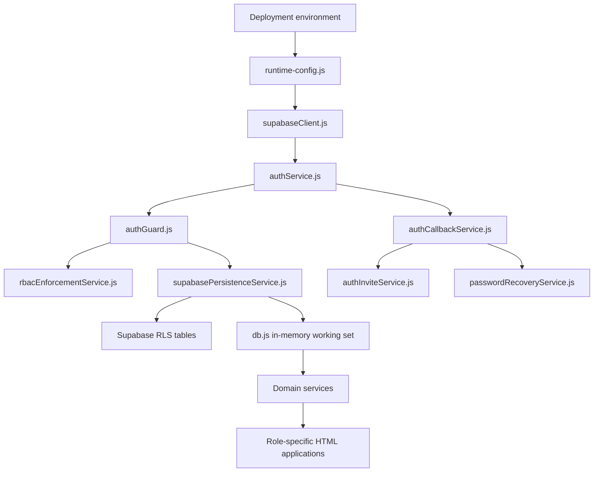
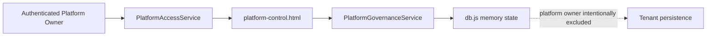
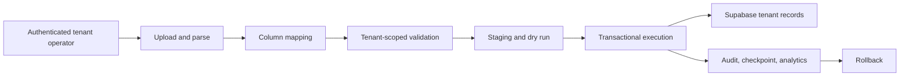

# ArthHRMS Platform Owner Architecture Audit

Audit date: 2026-07-25

## Scope And Baseline

This audit covers the source-controlled application, 37 HTML entry points, 202 browser services, 170 automated test files, build and deployment scripts, Supabase migrations and Edge Functions, runtime configuration, authentication, RBAC, tenant persistence, platform governance, onboarding, and import flows.

Verified baseline:

- `npm test`: 170 passed, 0 failed.
- JavaScript syntax: 202 service files and `db.js` passed `node --check`.
- `npm run build`: 37 HTML entry points generated.
- `npm run verify:deployment`: passed with six versioned migrations.
- Git worktree was clean before the first Platform Console slice.

An authenticated browser walkthrough could not be completed from the audit environment. Visual and interaction findings in this report are source-level findings and must be followed by an authenticated desktop/mobile browser pass.

## System Dependency Graph

The architecture has one canonical browser Supabase client and one canonical runtime-config contract. The principal coupling risk is the global `window` service namespace: 673 exported globals and a large optional-dependency cycle make behavior sensitive to script load order.

## Authentication Flow

```mermaid
flowchart LR
    L["Company or Platform login"] --> SP["Supabase signInWithPassword"]
    SP --> SV["getSession plus server getUser"]
    SV --> MD["Trusted app_metadata role and tenant claims"]
    MD --> RR["Post-authentication role routing"]
    RR --> PG["Shared route guard"]
    PG --> RB["Central RBAC route decision"]
    RB --> HY["Tenant state hydration or platform isolation"]
```

Company and Platform Owner login surfaces are separate. Invite, recovery, magic-link, signup, and email-confirmation callbacks are dispatched by callback type. Password recovery does not link an employee. Session expiration, user identity continuity, trusted role metadata, tenant claims, and email verification are validated before protected pages render.

## RBAC Flow

`authGuard.js` owns page policies. `authService.authorizePage()` validates the authenticated principal. `rbacEnforcementService.authorizeRoute()` makes the fail-closed route decision. Tenant services add resource/action and tenant checks.

Platform Owner is allowed only on platform resources and is explicitly blocked from tenant business resources. Tenant roles are blocked from platform resources. No Platform Owner access is granted to company profile, employee, HR, manager, admin, or Super Admin dashboards.

## Navigation Flow

The application is a static multi-page application. Each protected HTML entry point loads the shared guard. Role routing selects a role home after authentication. Platform Control links only to routes whose central policy explicitly allows Platform Owner.

Before the Platform Console shell slice, most capabilities were hidden inside one 2,300-line monitoring panel and the dashboard content rendered above every selected panel. The first slice contains dashboard content within its panel and provides grouped, searchable, keyboard-accessible navigation without changing route authorization.

## Company Flow

```mermaid
flowchart LR
    PO["Platform Owner"] --> TP["TenantProvisioningService"]
    TP --> TM["Tenant metadata"]
    TM --> OW["Enterprise organization setup wizard"]
    OW --> IV["Validation and review"]
    IV --> IN["Administrator invitation"]
    IN --> TA["Tenant administrator session"]
    TA --> CP["Company profile and business configuration"]
    CP --> DB["Tenant-scoped Supabase persistence"]
```

Tenant company settings, structures, policies, users, imports, audit records, and configuration versions are represented in the canonical tenant persistence definitions. Platform-side tenant metadata is not yet durable in deployed Supabase migrations.

## Platform Flow

This is the primary production blocker for Platform Owner expansion. Global governance, tenant directory, billing, rollout, and platform audit state require a dedicated platform schema and RLS boundary. Platform Owner must not be added to tenant persistence policies as a shortcut.

## Import Flow

Organization and employee import services provide validation, duplicate detection, dry-run, checkpoint, resume, and rollback models. Generic global aliases such as `ColumnMapper`, `ConflictResolver`, and `RollbackManager` are exported by multiple services; these aliases must be replaced with domain-owned names before more import modules are added.

## Deployment Flow

```mermaid
flowchart LR
    PR["Pull request"] --> CI["Tests, deployment verification, Deno checks"]
    CI --> IMG["Container build and deterministic dist artifact"]
    IMG --> REL["Protected manual release"]
    REL --> MIG["Migration dry run and apply"]
    MIG --> CFG["Hosted Auth and CORS configuration"]
    CFG --> FN["Invite Edge Function deployment"]
    FN --> GHCR["Immutable image publication"]
```

The release workflow does not deploy the published image or switch application traffic. Database migrations are applied before the image is published, and there is no automated database rollback or restore gate. Vercel uses the verified `dist` output but is operationally separate from the image release workflow.

## Supabase Flow

Tenant business persistence uses authenticated user context, app metadata tenant claims, forced RLS, authenticated grants, and generic domain tables. Platform Owner is excluded from these policies. Document storage uses tenant and employee path policies. The invite Edge Function validates the caller with Supabase Auth and keeps the service role server-side.

Current scalability risk: each in-memory save evaluates 132 persistence definitions sequentially, while hydration loads broad record-type projections. This must evolve into domain-level repositories and incremental queries before large-enterprise claims can be certified.

## Findings

### Critical

- Platform governance and tenant directory mutations are not durably persisted for Platform Owner.

### High

- `platform-control.html` is a 1.98 MB monolith that loads 160 services.
- Platform runtime code contains tenant-specific fallback identifiers.
- The global service namespace has extensive alias collisions and load-order coupling.
- Tenant persistence performs broad snapshot synchronization instead of domain-level writes.
- Production release automation has no traffic switch, application deployment, or database rollback execution.

### Medium

- One broken navigation target references nonexistent `employees.html`.
- Two validation pages contain duplicate DOM IDs.
- CSP requires `unsafe-inline` because inline event handlers remain widespread.
- Several operational pages are reachable only by direct URL and have weak discoverability.
- Local Supabase configuration permits six-character passwords, below the application recovery policy.
- The architecture map under `context` is stale and conflicts with the deployed persistence architecture.

### Low

- Generated self-test code is shipped inside many production service bundles.
- Styling and behavior are heavily embedded in HTML, limiting cacheability and reviewability.
- Static pages have inconsistent landmark, table caption, and control-label patterns.

## Module Status

| Platform module | Current status | Required next boundary |
| --- | --- | --- |
| Dashboard | Implemented, shell modernization started | Lazy data composition and browser QA |
| Companies | Partial | Durable platform tenant registry and lifecycle CRUD |
| Company Onboarding | Partial | Durable drafts and secure provisioning orchestration |
| Users / Identity & Access | Partial | Platform identity repository, MFA/session device views |
| Imports | Partial | Domain-owned services and worker-backed execution |
| Operations / Monitoring | Broad but monolithic | Split by route and lazy-load service bundles |
| Governance / Audit | Partial | Immutable platform audit persistence |
| Analytics | Read-model foundation | Durable aggregate pipeline |
| Billing | Governance model only | Billing provider boundary and durable ledger |
| Branding / Feature Flags | Functional in memory | Durable platform configuration |
| Deployments | Validation model | Actual deploy/traffic/rollback integration |
| Notifications / Integrations | Tenant-oriented foundations | Platform provider operations boundary |
| Settings | Functional in memory | Versioned platform settings persistence |
| Support | Incident foundations | Dedicated platform support workflow |
| Test Lab | Existing protected route | Browser and environment evidence integration |

## Phased Implementation Plan

1. Platform Console shell: grouped navigation, dashboard containment, search, deep links, keyboard behavior, responsive and theme-ready styling.
2. Platform data boundary: dedicated versioned migrations, forced RLS, immutable audit, optimistic versioning, and platform-only persistence tests.
3. Company Management: tenant registry, lifecycle states, safe archive/suspend, pagination, usage read models, and onboarding links.
4. Identity and access: platform user/session views, MFA and policy posture, API keys and SSO governance without exposing tenant users.
5. Operations and governance: split the monolith into route-level bundles and domain-owned services.
6. Analytics and billing: durable aggregates, provider abstractions, reconciliation, and finance-grade audit.
7. Security and performance: remove inline handlers, tighten CSP, introduce domain repositories, incremental queries, and virtualization.
8. Certification: authenticated role matrix, cross-tenant probes, mobile/desktop accessibility, load tests, backup/restore evidence, and deployment rehearsal.

Each phase must leave all existing routes operational, add focused tests, run the full regression suite, build deterministic artifacts, and pass deployment verification.
